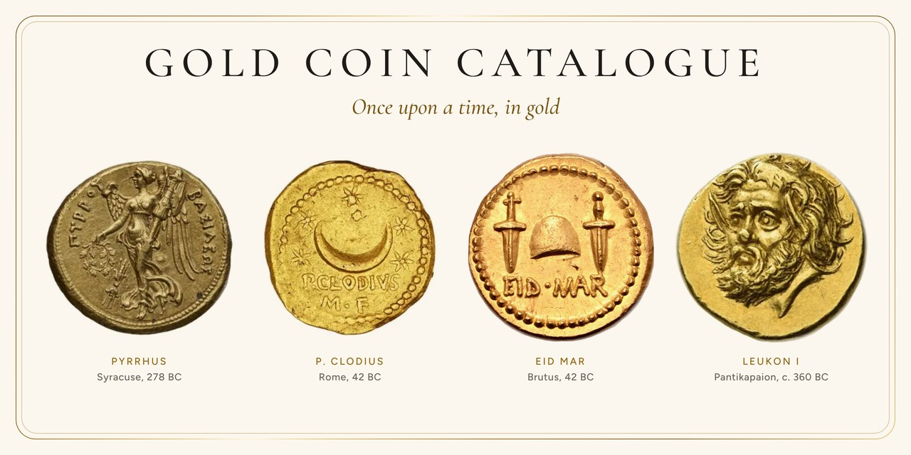
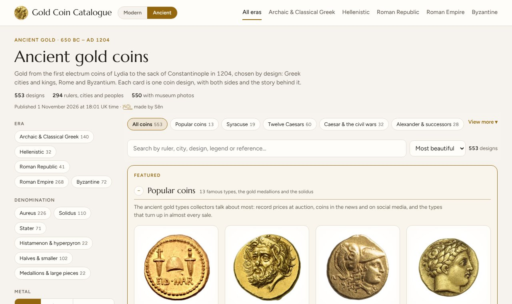

# Gold Coin Catalogue

*Kingdoms rise and fall, palaces crumble to dust, yet their gold still turns up in a ploughed field, as bright as the day it was struck.* A wandering catalogue of the loveliest gold coins, from Lydia’s first electrum to the sovereigns of today, with both sides of every coin.

**[Open the catalogue →](https://escargot-studio.github.io/gold-coin-catalogue/)**  ·  [Ancient gold](https://escargot-studio.github.io/gold-coin-catalogue/ancient.html)

## Modern gold

Gold bullion coins from The Royal Mint, The Perth Mint, the Royal Australian Mint, the US Mint, the Royal Canadian Mint and more: Britannias, sovereigns, Queen's Beasts, Tudor Beasts, Lunar series, Kangaroos, Eagles, Buffalos, Maple Leafs and others.

- Filter by country, series, size (1 oz, 1/2, 1/4, 1/10 oz and more), stock, years and monarch.
- Hover a coin to flip it.
- Click a coin for both sides, specs per size, stock and, for British coins, UK Capital Gains Tax status (sterling legal tender is CGT-exempt).

## Ancient gold

Over 550 gold and electrum designs from the first coins of Lydia to the sack of Constantinople in 1204: Greek staters, Syracuse, Alexander the Great and his successors, the Ptolemies, Roman aurei and Byzantine solidi.

- One card per design, with museum photos and the story behind it.
- Collections such as Popular coins, the Twelve Caesars, the Ides of March (EID MAR), Women on gold, Animals on gold and the most expensive ancient coins ever sold.
- Estimated price ranges from recent public auction results.

## About

The catalogue sells nothing and isn't affiliated with any mint, museum, auction house or dealer. Stock and prices are dated snapshots. Tax notes are a reference, not tax advice.

Photos come from The Royal Mint, dealers and museum open-access collections (The Cleveland Museum of Art, The Metropolitan Museum of Art, Münzkabinett Berlin, Wikimedia Commons and others); each coin's record names its source and licence.

## Licence

Share image coins: Pyrrhus’s stater, Bibliothèque nationale de France (CC BY 4.0); P. Clodius aureus, American Numismatic Society; EID MAR aureus, Roma Numismatics Auction XX (2020); Leukon I stater, Numismatica Ars Classica (2023).

The page in this repo is under the MIT License (see LICENSE). Full-size coin photos are not stored here: they're linked from their owners' sites and remain their property. Small credited thumbnails (ancient-img/, history-map-img/) are kept for speed. The site icon is the EID MAR aureus reverse, from a Roma Numismatics Auction XX (2020) photo.
